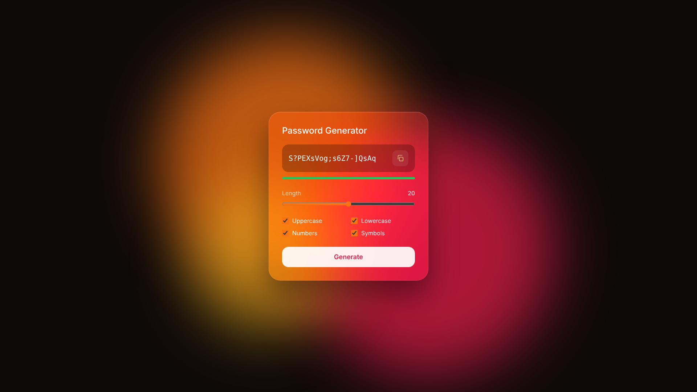

<div align="center">

# Glass Password Generator

A secure password generator with a glassmorphism design, built from scratch with pure HTML, CSS and JavaScript.




</div>

## About

A minimal password generator with a frosted glass card floating over a warm, animated gradient background. Every password is generated with the browser's cryptographically secure random number generator. No frameworks, no libraries, just the fundamentals of the web.

## Features

- **Glassmorphism UI** with `backdrop-filter` blur and an animated gradient background
- **Adjustable length** from 8 to 32 characters
- **Character options**: uppercase, lowercase, numbers and symbols
- **Guaranteed variety**: every password includes at least one character of each selected type
- **Secure randomness** with `crypto.getRandomValues()`
- **Strength bar** based on password entropy
- **One-click copy** to the clipboard
- **Live updates**: a new password is generated whenever an option changes

## How the strength is calculated

The strength bar uses the password's entropy, measured in bits:

```
entropy = length × log2(number of possible characters)
```

| Entropy | Strength |
|---|---|
| Below 40 bits | Weak |
| 40 – 59 bits | Fair |
| 60 – 79 bits | Good |
| 80 bits or more | Strong |

## Project structure

```
glass-password-generator/
├── index.html   # Layout, options and buttons
├── style.css    # Glass effect, animated background and component styles
└── script.js    # Password generation, strength meter and copy logic
```

## Getting started

No installation needed. Clone the repository and open `index.html` in your browser:

```bash
git clone https://github.com/moschettimarcos/glass-password-generator.git
cd glass-password-generator
```

## License

This project is licensed under the [MIT License](LICENSE).